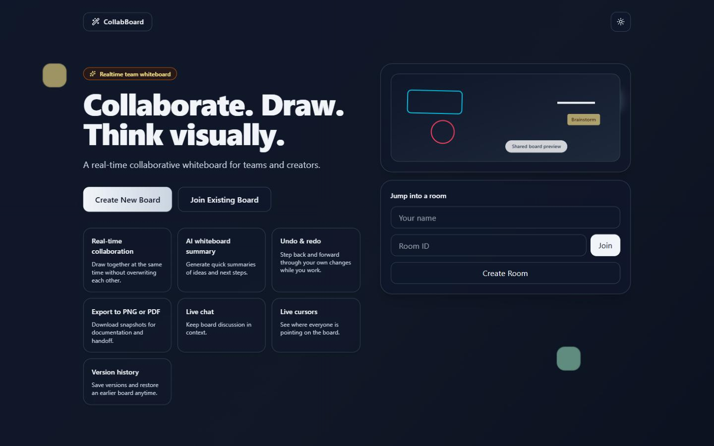
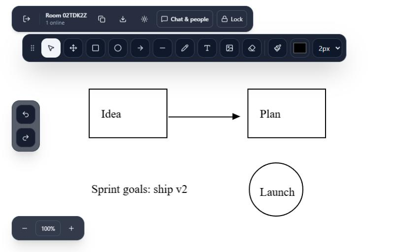
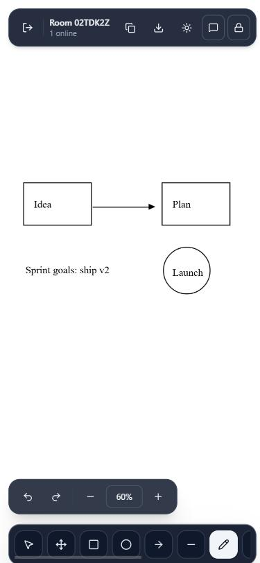

# CollabBoard — Collaborative Whiteboard

A real-time collaborative whiteboard built with React and Firebase. Create a room, share the room ID, and draw, write, and chat together.

**Live demo:** https://anand-whiteboard.netlify.app

## Screenshots




<p align="center">
  
</p>

## Features

- Create or join rooms with a short room ID
- Real-time drawing synced to everyone in the room — each item is saved separately, so people can draw at the same time without overwriting each other
- Tools: select, hand (pan), pencil, rectangle, circle, line, arrow, text, image upload, eraser
- Stroke colour and width, canvas background colour, zoom
- Undo and redo (your own changes)
- Version history: save versions, restore earlier boards (the host auto-saves every 10 minutes)
- Live cursors and a live "online" list (needs Firebase Realtime Database)
- Live chat and participant list
- Host can lock the board so collaborators can view but not edit; anyone who tries to draw on a locked board sees a short notice
- AI board summary (Google Gemini, called through a Netlify Function so the API key stays private), shown as formatted headings and bullet points
- Export the board as PNG or PDF
- Light and dark mode
- Layouts for phone, tablet and desktop: on phones the toolbar sits along the bottom and chat and participants open as a sheet


## Tech stack

- React 19 + Vite 8
- Tailwind CSS, Framer Motion, Lucide icons
- Fabric.js 5 (canvas engine, loaded from cdnjs with jsDelivr and unpkg as fallbacks)
- Firebase Authentication (anonymous) + Cloud Firestore (rooms, board items, versions, chat)
- Firebase Realtime Database (optional: live cursors and presence)
- Netlify hosting + Netlify Functions (AI summary)

## Getting started

```bash
git clone https://github.com/Anandkanil/collab-whiteboard.git
cd collab-whiteboard
npm install
cp .env.example .env   # then fill in your Firebase values
npm run dev
```

The app runs at http://localhost:5173.

To test the AI summary locally, use the Netlify CLI instead of `npm run dev`:

```bash
npx netlify dev
```

## Environment variables

| Variable | Where | Purpose |
| --- | --- | --- |
| `VITE_FIREBASE_*` | `.env` and Netlify | Firebase web app config (public by design) |
| `VITE_APP_ID` | `.env` and Netlify | Namespace for rooms in Firestore |
| `VITE_FIREBASE_DATABASE_URL` | `.env` and Netlify (optional) | Realtime Database URL; enables live cursors and the online list |
| `GEMINI_API_KEY` | Netlify only | Gemini API key for the AI summary. Never prefix with `VITE_`. |
| `GEMINI_MODEL` | Netlify (optional) | Override the Gemini model (default `gemini-flash-latest`, which always points at the current Flash model) |

## Scripts

- `npm run dev` — start the dev server
- `npm run build` — production build into `dist/`
- `npm run preview` — preview the production build
- `npm run lint` — run ESLint

## Project structure

```
src/
  App.jsx        # app, landing page, and whiteboard
  main.jsx       # React entry point
  index.css      # Tailwind setup
netlify/
  functions/
    summarize.mjs  # AI summary endpoint
netlify.toml     # Netlify build settings
firestore.rules  # Firestore security rules
database.rules.json  # Realtime Database security rules
```

## Firebase security rules

The Firestore rules live in `firestore.rules` and the Realtime Database rules in `database.rules.json`. Paste them into the Firebase console (Firestore Database → Rules, and Realtime Database → Rules) and click Publish whenever they change.

## Deployment

Pushing to `main` deploys automatically to Netlify.

## Author

[@Anandkanil](https://github.com/Anandkanil)
